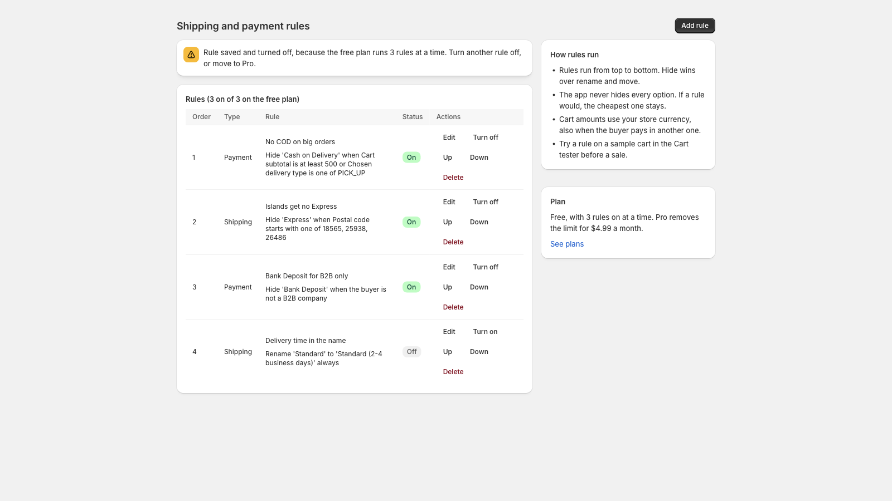

# Zovo Hide Shipping & Payment

A Shopify app that hides, renames and sorts shipping options and payment methods at checkout. It runs as two Shopify Functions (delivery customization and payment customization), so it works on every Shopify plan, not only Shopify Plus.

Free for 3 rules. Pro removes the limit for $4.99 a month or $49 a year, billed by Shopify.



## What merchants use it for

- Hide Cash on Delivery above a cart value, or when the buyer picks store pickup.
- Hide Express shipping for islands and remote postal codes.
- Show Bank Deposit only to B2B buyers or to customers with a tag such as `vip`.
- Put the cheapest or free option at the top, or add the delivery time to a shipping name.

## Conditions

| Condition | Tests |
|---|---|
| Cart subtotal | at least, less than (store currency, also for buyers who pay in another currency) |
| Item count, cart weight in kg | at least, less than |
| Country, postal code prefix | one of, none of |
| Customer tag | has any of, has none of |
| Product tag | any item has, no item has (up to 5 tags in total) |
| B2B company buyer, logged-in customer | yes, no |
| Chosen delivery type (payment rules) | one of, none of (`SHIPPING`, `PICK_UP`, `PICKUP_POINT`, `LOCAL`) |

A rule can need all of its conditions or any of them. Rules run from the top of the list. Hide wins over rename and move. The app never hides every option in a group. If a rule would, the cheapest option stays, so a buyer can always finish checkout.

## Screens

| Screen | What it does |
|---|---|
| Rules | List, turn on or off, reorder, delete. Shows how many rules the plan runs. |
| Rule editor | One rule with up to 3 conditions. |
| Cart tester | Build a sample cart and see what the buyer gets. It runs the same code as the Functions. |
| Plan | Free and Pro, through the Shopify Billing API. |

## How it is built

- Official Shopify app template for React Router (`@shopify/shopify-app-react-router`), Polaris web components and App Bridge.
- `shared/rules-engine.js` holds all rule logic in plain JavaScript. The two Functions and the cart tester import the same file.
- `extensions/delivery-rules` targets `cart.delivery-options.transform.run`. `extensions/payment-rules` targets `cart.payment-methods.transform.run`. Both read one JSON metafield (`$app:checkout-rules` / `function-configuration`) that also feeds the input query variables for customer and product tags.
- Rules are saved on the app installation, and the Function config is copied to each customization in one `metafieldsSet` call. Billing is configured in `app/shopify.server.ts`. Development stores get test charges. A plan change (webhook `app_subscriptions/update`) rewrites the Function config, so checkout follows the plan without a page visit.
- Scopes are `write_payment_customizations` and `write_delivery_customizations` only. The app reads no orders and stores no customer data.

## Run the tests

```sh
npm install
npm test            # app tests (vitest) and both Function suites
npm run typecheck
npm run build
```

`npm test` runs 51 app tests against an in-memory fake of the Admin API and the Billing API (`tests/fake-shop.ts`). It also runs 24 Function fixtures. The Function suites compile each Function to wasm with the Shopify CLI and run every fixture in Shopify's function runner. You need no Partner login for any of this.

To run one Function by hand:

```sh
cd extensions/delivery-rules
npx shopify app function run --input path/to/input.json --export cart-delivery-options-transform-run
```

`npm run preview:render` writes the admin screens to `preview/*.html` from the real loader and action code. The listing screenshots come from those pages.

## Function limits

Shopify stops a Function after 11 million instructions on carts up to 200 lines. Most of that budget goes on reading the input. Measured with the Shopify function runner (`shopify app function run`):

| Cart lines | Rules | Product tags | Instructions |
|---|---|---|---|
| 10 | 5 | 2 | 3.2M |
| 50 | 10 | 3 | 7.3M |
| 100 | 10 | 5 | 12.3M |
| 200 | 3 | 0 | 9.8M |

On a cart of about 100 lines or more with product tag rules, Shopify can stop the Function. Checkout then shows all options as if the app were not installed. The rule editor says this next to the conditions. The app caps product tags at 5 to keep normal carts well inside the budget.

## Deploy

See `OWNER-STEPS.md`. In short, link the app with `shopify app config link`, host the web app with the environment variables below, then run `shopify app deploy`.

| Variable | Value |
|---|---|
| `SHOPIFY_API_KEY`, `SHOPIFY_API_SECRET` | From the app in the Dev Dashboard |
| `SHOPIFY_APP_URL` | Public HTTPS URL of the host |
| `SCOPES` | `write_payment_customizations,write_delivery_customizations` |
| `SHOPIFY_BILLING_TEST` | `1` only on a staging host |

The template stores sessions in SQLite through Prisma. On a host with a persistent volume that works as is. Otherwise switch the Prisma datasource to Postgres.

[zovo-support-start]: #

## Support Zovo

Zovo builds and maintains this app. If it saves you time, you can support the work on [GitHub Sponsors](https://github.com/sponsors/theluckystrike). Sponsorship is optional, and the tool works the same without it.

The app itself takes payment only through Shopify billing.

Zovo is made by [theluckystrike](https://github.com/theluckystrike) on GitHub.

## More tools by Zovo

- [All Zovo tools on GitHub](https://github.com/theluckystrike?tab=repositories). Free developer tools for VS Code, Apify, Confluence, Jira and Minecraft servers.

[zovo-support-end]: #

## License

MIT. See `LICENSE`. Template notice in `THIRD-PARTY-NOTICES.txt`.
